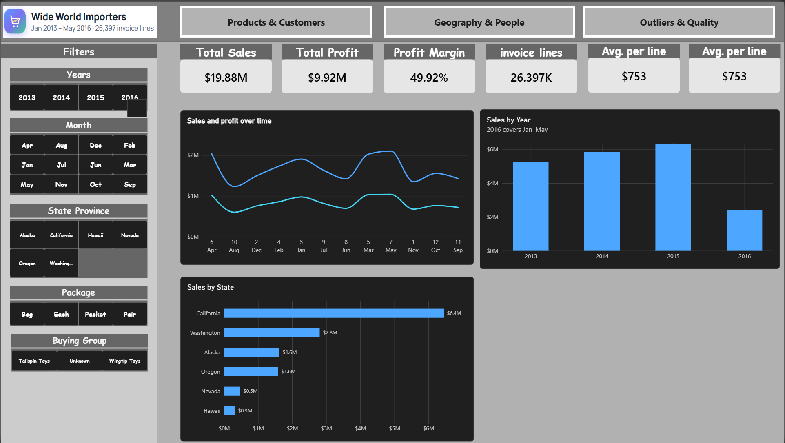
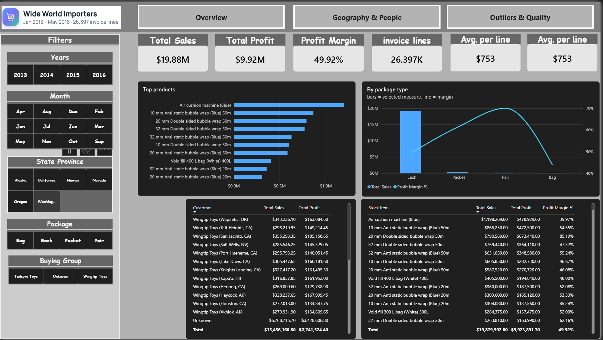
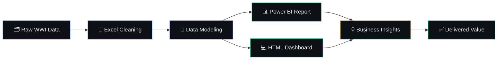

<div align="center">

<!-- Animated Header Banner -->


<!-- Animated Typing -->


<br/>

<!-- All Badges -->
[](.) [](.) [](.) [](.) [](https://powerbi.microsoft.com/) [](https://developer.mozilla.org/en-US/docs/Web/HTML) [](https://microsoft.com/excel)

</div>

---

## 👋 About Me

I'm **Ali Mersal**, a Data Analyst with a passion for turning messy data into clear business decisions.
I work across the full analytics workflow — from raw data cleaning all the way to interactive dashboards and actionable insights.

---

## ⚡ What I Built

I took raw sales data from Wide World Importers and built a complete analytics project from scratch.
I cleaned the data, created **4 Power BI report pages**, and coded a fully interactive HTML dashboard — all in one project.

The screenshots below are selected views. To explore the full project, open the live dashboard or download the repo:

<div align="center">

[](https://alimersal.github.io/Data-Analysis-Exam-Answers-/)
[](https://github.com/alimersal/Data-Analysis-Exam-Answers-/archive/refs/heads/master.zip)
</div>

---

## 📸 Project Showcase

<div align="center">

### 🔵 Power BI — Executive View



### 🟢 Power BI — Deep Dive



### 🟣 HTML Dashboard — Main View


### 🟠 HTML Dashboard — Alternative View


</div>

---

## 🎯 What I Accomplished

| ✅ | What I Did |
|---|---|
| 🧹 | Cleaned the raw WWI dataset — removed nulls, fixed duplicates, corrected data types |
| 📊 | Built **4 Power BI report pages** with KPIs, slicers, drill-through, and custom visuals |
| 💻 | Coded a responsive HTML dashboard with dark/light theme, sidebar filters, and interactive charts |
| 💡 | Delivered clear business insights backed by data — not assumptions |

---

## 📊 Dashboard Features

| Feature | What It Does |
|---|---|
| 📌 KPI Cards | Show key numbers with trend indicators |
| 🔎 Smart Filters | Filter by region, category, salesperson, or date |
| 🌓 Dark / Light Theme | Switch themes instantly with no flicker |
| 📱 Responsive Layout | Works on any screen size |
| 📋 Data Tables | Sortable tables with row highlighting |
| 🔍 Drill-Through | Click any chart to filter everything |

---

## 🔍 My Analysis Process



---

## 📁 Project Structure

```
📂 Data-Analysis-Exam-Answers/
├── 📄 index.html                 # HTML web dashboard
├── 📊 Sales_Dashboard.pbix       # Power BI report (4 pages)
├── 📋 WWI_Sales_Cleaned_EDA.xlsx # Cleaned data + EDA
└── 📁 Assets/                    # Project screenshots
```

---

## 🚀 How to Run

**Option 1 — View HTML Dashboard online** *(no install needed)*

👉 [Open Live Dashboard](https://alimersal.github.io/Data-Analysis-Exam-Answers-/)

**Option 2 — Run locally:**
```bash
git clone https://github.com/alimersal/Data-Analysis-Exam-Answers-.git
start index.html
```

**Option 3 — Power BI Report** — open `Sales_Dashboard.pbix` with [Power BI Desktop](https://powerbi.microsoft.com/desktop/) (free).

**Option 4 — Excel Workbook** — open `WWI_Sales_Cleaned_EDA.xlsx` to explore the cleaned data and pivot analysis.

---

## 💡 Key Insights I Found

- 📈 I found the top product categories driving most of the revenue
- 🌍 I spotted regions that were underperforming compared to their potential
- 📅 I discovered seasonal sales spikes that can guide inventory planning
- 👤 I grouped customers by value to identify the most important accounts
- 💸 I flagged low-margin products that were quietly hurting profit
- 🔄 I tracked each salesperson's performance to highlight growth opportunities

---

## 🤝 Let's Connect

<div align="center">

[](https://www.linkedin.com/in/ali-mersal-7116641bb/)
[](mailto:ali.m.mersal@gmail.com)

</div>

---

<div align="center">

<!-- Animated Footer -->


<sub>📊 Data tells a story — I make sure it's heard · <strong>Wide World Importers Sales Analytics</strong></sub>

</div>
